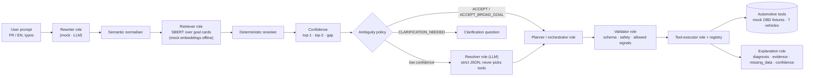

<div align="center">

# 🚗 Multi-Agent AI Vehicle Diagnostic Assistant

**An intelligent automotive-diagnostic assistant: natural-language understanding, diagnostic orchestration over OBD tools, safety validation and confidence-aware answers. This repository contains the AI orchestration layer of the project.**


-f472b6?style=for-the-badge&labelColor=0c0814)


</div>

---

## 📌 Project Overview

A driver or workshop technician asks, in French or English and with typos — *"je vx conaitre l etat de ma voiture"*, *"check my car health"*, *"read dtc"*, *"why is my battery weak"* — and the assistant works out what is being asked, decides which automotive tools to use, checks the plan for safety, runs the tools, and answers with a diagnosis, evidence, missing data, recommendations and a bounded confidence score.

The project was developed and presented as a **Multi-Agent AI Vehicle Diagnostic Assistant**: specialised roles (understanding, retrieval, planning, validation, tool execution, explanation) cooperate around OBD-II vehicle data to produce traceable diagnostic workflows. It is a **team project**; this repository is the AI orchestration layer.

## 🧩 Overall Project vs. This Repository

The table relates the **overall project architecture** to the part that is **implemented and runnable in this repository** (the AI orchestration layer, covered by 100 passing tests).

| Capability | Overall project | This repository |
|---|---|---|
| **Multi-agent diagnostic orchestration** | Specialised agents (understanding, retrieval, planning, validation, tool execution, explanation) collaborating on diagnostic workflows | ✅ **Orchestration layer implemented here** — rewriter, goal retriever/reranker, resolver/planner, plan validator, tool executor and response composer, coordinated by one orchestrator |
| Natural-language understanding (FR/EN, typos) | ✅ | ✅ Implemented — semantic normaliser, SBERT goal retrieval, deterministic rerank, ambiguity policy |
| LLM assistance | ✅ | ✅ Implemented as optional providers (mock default; OpenAI, Gemini, OpenRouter); the LLM never selects tools directly |
| Automotive tool layer (`get_vehicle_context`, `get_dtcs`, `get_latest_signals`, `get_signal_history`, `get_capabilities`, `request_fresh_signals`, `request_mode06`, `score_confidence`) | ✅ | ✅ Implemented over **mock OBD data** (7 vehicle scenarios) |
| Safety and schema validation, confidence scoring, "missing data" reporting | ✅ | ✅ Implemented |
| **Knowledge retrieval** (project design: RAG layer) | Retrieval-augmented knowledge layer for diagnostics | ✅ Semantic retrieval over diagnostic "goal cards" (built from diagnostic profiles), wired into the planner |
| Embedded acquisition (STM32 + ELM327) → MQTT → server cache | Project system design | Mocked in this repository with JSON fixtures (7 vehicle scenarios) |

<!-- Status rows above reflect the code available in this repository. -->

## 🧭 Architecture of This Repository



**Public intents:** `READ_DTC`, `CHECK_CYLINDER`, `CHECK_ENGINE_HEALTH`, `CHECK_SIGNAL_STATUS`, `EXPLAIN_WARNING_LIGHT`, `GET_VEHICLE_CONTEXT`, `UNKNOWN`.
**Internal goals:** `VEHICLE_HEALTH_CHECK`, `READ_DTC`, `CYLINDER_CHECK`, `SIGNAL_STATUS_CHECK`, `WARNING_LIGHT_CHECK`, `BATTERY_CHECK`, `ENGINE_TEMPERATURE_CHECK`, `PERFORMANCE_ISSUE_CHECK`, `STARTING_PROBLEM_CHECK`, `FUEL_CONSUMPTION_CHECK`, `VEHICLE_CONTEXT_LOOKUP`.
**Allowed signals:** `rpm`, `engine_load`, `coolant_temp`, `throttle_pos`, `stft_b1`, `ltft_b1`, `o2_b1s1`, `vehicle_speed`, `module_voltage`.

## ✅ Verified Behaviour (executed)

**Test suite — 100 passed** (`pytest -q`, Python 3.10, `pydantic 2`, `pytest 9`, mock providers, ≈ 43 s).

**Prompt suite — broad health prompts on mock vehicle `veh_002`** (healthy baseline). Real output, mock embeddings:

| Prompt | Intent / goal | Resolution | Tool plan | Final confidence |
|---|---|---|---|---:|
| *je veux connaître le health de ma voiture* | `CHECK_ENGINE_HEALTH` / `VEHICLE_HEALTH_CHECK` (broad) | `ACCEPT_BROAD_GOAL` | `get_vehicle_context → get_dtcs → get_latest_signals → request_fresh_signals → score_confidence` | 0.32 |
| *je vx conaitre l etat de ma voiture* | same | same | same | 0.32 |
| *check my car health* | same | same | same | 0.34 |
| *is my car okay* | same | same | same | 0.38 |

Typo-laden and clean prompts resolve to the same goal and plan, and the assistant asks a clarifying question (*"Voulez-vous un bilan général du véhicule ou un problème plus précis ?"*). Confidence values are **low because the offline mock embedding provider is used**; they are not accuracy figures, and no intent-accuracy benchmark exists yet.

## 🧰 Tech Stack

| Role | Tools |
|---|---|
| Core | Python 3.10, Pydantic v2 (strict request/response contracts) |
| NLP | Sentence-Transformers (`paraphrase-multilingual-MiniLM-L12-v2`) with an offline deterministic mock fallback |
| LLM providers (optional) | OpenAI, Google Gemini (`google-genai`), OpenRouter — all off by default |
| Validation | custom plan, schema and safety validators |
| Testing | pytest |

## 🗂️ Structure

```text
agent/        orchestrator, retriever, reranker, confidence, ambiguity, response composer, mock tools
nlp/          resolver / rewriter prompts and schemas
tools/        tool registry and executor
validation/   plan, schema and safety validators
backend/      Pydantic AgentRequest / AgentResponse contracts
data/         goal catalog, diagnostic profiles, signal mapping, mock runtime scenarios
fake_data/    JSON fixtures for the OBD tools (vehicles veh_001 … veh_007)
demo/         run_prompt_suite.py · run_real_mode_demo.py
docs/         use cases, JSON contracts, hybrid pipeline, real-mode testing
tests/        unit and end-to-end scenarios
```

## 🚀 Run

> `main` has no dependency file; the branch `codex/csv-business-layer-runtime-mocks` adds `requirements.txt` and a detailed teammate README. Dependencies declared there: `pydantic>=2,<3`, `pytest>=8,<10`, `openai>=1,<2`, `google-genai>=1,<2`, `sentence-transformers>=3,<4`.

```bash
python -m venv .venv && source .venv/bin/activate     # Windows: .venv\Scripts\Activate.ps1
pip install -r requirements.txt                       # or at least: pydantic pytest

# fully offline mode (no API keys, no model download)
export INTENT_EMBEDDING_PROVIDER=mock INTENT_REWRITER_PROVIDER=mock INTENT_RESOLVER_PROVIDER=mock

pytest -q
python demo/run_prompt_suite.py --category broad_health --vehicle-id veh_002
python demo/run_real_mode_demo.py                     # interactive: vehicle id + prompt
```

Optional providers (`sbert`, `openai`, `gemini`, `openrouter`) are selected with the variables in `.env.example`. The business-knowledge CSV (`DIAGNOSTIC_PROFILE_CSV_PATH`) is **not** committed; without it, CSV-derived enrichment is reduced but the project still runs.

## 📚 Documentation

[Use cases](./docs/use_cases_v2.md) · [JSON contracts](./docs/json_contracts_v2.md) · [Hybrid goal pipeline](./docs/hybrid_goal_pipeline.md) · [Real-mode testing](./docs/real_mode_testing.md) · [Migration notes](./docs/hybrid_agent_migration.md)

## 🔭 Roadmap

- Connect the STM32/ELM327 gateway behind the existing tool interface.
- Integrate the remaining layers of the overall design (document knowledge base, additional collaborating agents) with this orchestration layer, with tests and an evaluation.
- Build a labelled FR/EN/typo prompt set to measure intent accuracy and calibrate confidence thresholds with real SBERT embeddings.
- Reconcile provider settings between `.env.example` and `docs/real_mode_testing.md`; add CI.

## 👤 Author

**Nour Ghribi** · [GitHub](https://github.com/Nour-Ghribi)
